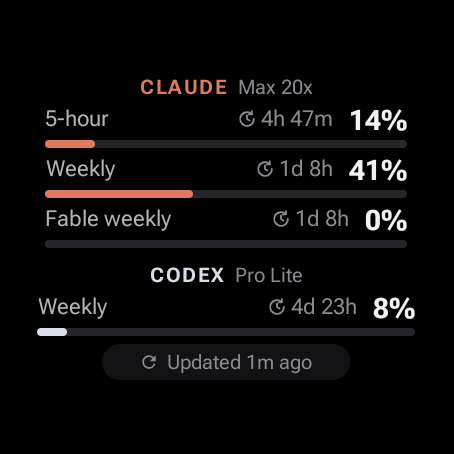
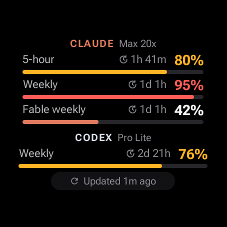
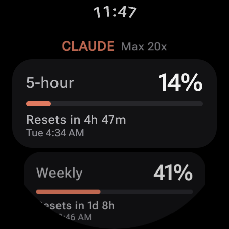
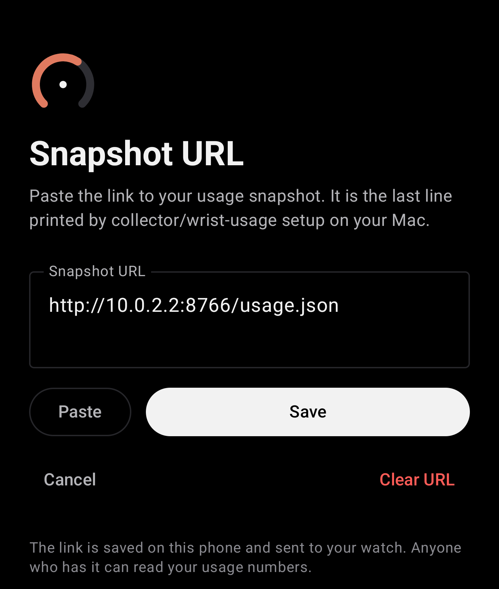

# Wrist Usage

Shows your Claude and Codex usage limits on your Wear OS watch, as a tile, an app and a watch-face complication.

Check how much of your 5-hour and weekly limits are left without opening a laptop. Built for a Samsung Galaxy Watch 6.

Watch:

<p>
  
  
  
</p>

Phone:

<p>
  
</p>

The screenshots use demo data and come from emulators.

---

## How to install

There are three parts: a collector on your Mac, an app on your Android phone and an app on your watch. Do the Mac first, because the phone needs the link that Mac setup prints. The watch gets the link and the data from the phone.

The phone app and watch app have to be signed with the same key, or they will not talk to each other. Install both from the same release, or build both yourself on the same machine.

Downloads: https://github.com/Whyater/Wrist-Usage/releases/tag/v0.2.0 (look for `wrist-usage-phone-0.2.0.apk` and `wrist-usage-watch-0.2.0.apk`).

### Mac

You need:

- A Mac with Python 3.9 or newer (the built-in `/usr/bin/python3` works)
- GitHub CLI (`gh`), signed in with `gh auth login` (it needs the gist scope)
- Claude Code signed in with a Claude subscription, and/or the Codex CLI signed in with ChatGPT (`codex login`)

Get the code:

```sh
git clone https://github.com/Whyater/Wrist-Usage.git
cd Wrist-Usage
```

Check what the collector sees. This prints the snapshot and publishes nothing:

```sh
collector/wrist-usage collect
```

Run setup. Add `--dry-run` first if you want to see what it would do:

```sh
collector/wrist-usage setup
```

Setup creates a secret GitHub gist with your first snapshot and installs a background job (launchd) that refreshes it every 5 minutes. It prints the gist's raw URL (the line starting with `https://`). Copy that URL.

To see the URL again later:

```sh
collector/wrist-usage url
```

If you move the folder later, run setup again.

### Android phone

You need an Android phone with Google Play services (Android 8.0 or newer) that is paired with your watch. iPhones are not supported.

1. On the phone, download `wrist-usage-phone-0.2.0.apk` from the [v0.2.0 release](https://github.com/Whyater/Wrist-Usage/releases/tag/v0.2.0).
2. Open the file. When Android asks, allow installing apps from that source.
3. Open Wrist Usage, paste the URL from the Mac (the Paste button reads your clipboard) and tap Save. The app downloads the URL once to check it.

The phone now shows your usage and sends the URL and each new snapshot to the watch. To change the URL later, tap Change URL.

### Galaxy Watch / Wear OS

Install the watch app once from your Mac with `adb`. You need a Wear OS 3 or newer watch (minSdk 30), and the watch and Mac on the same Wi-Fi.

Get `adb` (Android platform-tools):

```sh
brew install --cask android-platform-tools
```

Download `wrist-usage-watch-0.2.0.apk` from the [v0.2.0 release](https://github.com/Whyater/Wrist-Usage/releases/tag/v0.2.0), then:

1. On the watch, open Settings > About watch > Software information. Tap "Software version" 5 times to turn on Developer options.
2. Go to Settings > Developer options. Turn on ADB debugging and Wireless debugging. Tap "Pair new device" to see a pairing code and an IP:port.
3. On the Mac, pair and connect. Use the pairing port for the first command, and the port shown on the Wireless debugging screen for the second:

   ```sh
   adb pair <ip>:<pairing-port>
   adb connect <ip>:<port>
   ```

4. Install the app:

   ```sh
   adb install wrist-usage-watch-0.2.0.apk
   ```

5. Turn ADB debugging and Wireless debugging off again on the watch. Leaving wireless debugging on keeps the watch's Wi-Fi awake and drains the battery a lot. The app does not need it after install.

If you had an earlier test build on the watch, remove it first. It was signed with a different key, so Android will not update over it:

```sh
adb uninstall io.github.whyater.wristusage
```

Add the tile. On a Galaxy Watch, tiles are a swipe left from the watch face (swipe right is notifications, and apps cannot put screens there). Long-press a tile to add or reorder tiles. Add the tile (it is listed as "Usage") and move it first, so it is one swipe away.

To add the complication, long-press the watch face, choose Customize, then Complications. This only works if your watch face supports complications.

---

## Current features

- A tile with every limit for each provider: label, percent, a thin bar and the time until reset. Bars turn amber at 75% and red at 90%.
- "Updated Xm ago" in the footer, based on when the Mac collected the data. It turns amber when the data is over 30 minutes old or the last fetch failed. Tap the footer to refresh. Tap the tile to open the app.
- If there are too many limits to fit, the tile shows the highest ones and "+N more".
- A watch app with the full list, exact local reset times and a refresh button.
- A complication that shows your highest usage percent.
- A phone app with a one-time setup screen, the full list of limits, and a status line for the watch connection.
- The phone re-downloads the snapshot every 15 minutes in the background and sends each one to the watch. It sends the URL when you save it and each time the app starts, so no rebuild is needed to change it.
- When the phone is out of reach, the watch downloads the URL itself over Wi-Fi or LTE. Tapping refresh on the watch asks the phone first, and falls back to a direct download after about 20 seconds.
- Per-provider states for signed out ("Sign in again on the Mac") and errors. It keeps showing the last good data when offline.
- Claude: 5-hour and weekly limits, per-model weekly limits (like "Fable weekly"), and extra usage when it is enabled.
- Codex: 5-hour and/or weekly limits, and the code review limit when present.

### Battery

While the phone is nearby, the watch mostly receives data over Bluetooth instead of using its own Wi-Fi. The watch also checks on its own every 15 minutes, and it skips the download when the data is under 20 minutes old.

---

## Planned features

These are not built yet.

- More providers (for example Gemini CLI).
- Collector support for Linux.

---

## Known bugs / limitations

- The phone-to-watch sync over Bluetooth has not been tested on real devices yet. Only the separate pieces have been tested on emulators: the watch app on a Wear OS emulator and the phone app on a phone emulator.
- The watch app has run on the emulator, but not yet on a real Galaxy Watch 6.
- Android phones only. There is no iPhone app.
- Data can lag by up to about 10 minutes, sometimes more. The Mac publishes every 5 minutes, GitHub caches the gist file for about 5 minutes, and the phone fetches every 15 minutes (Android may delay background work when the phone is idle). The tile footer always shows the real age.
- The Mac has to be on, awake and online for the numbers to update. Usage from your phone or the web still counts, but it only shows up once the Mac publishes again.
- If you haven't used Claude Code for a while, its sign-in expires and the tile shows "Sign in again on the Mac". Run Claude Code once to fix it.
- It uses the same usage endpoints the official apps use. They are not public APIs and can change without notice.
- A secret gist is unlisted, not private. Anyone with the link can read it. It only holds percentages, plan names and reset times.
- The collector only runs on macOS.

---

## Privacy

- The collector reads the credentials that Claude Code and the Codex CLI already store on your Mac (Claude: a macOS keychain item, Codex: `~/.codex/auth.json`). It asks each provider for your current usage.
- The snapshot only has percentages, plan names and reset times. The format is in [docs/snapshot-format.md](docs/snapshot-format.md).
- Your tokens stay on the Mac and only go to Anthropic and OpenAI, the same way the official tools use them. The gist, the phone and the watch never see them.
- The collector never refreshes tokens itself, because that could sign Claude Code or Codex out.

Collector logs are written to `~/Library/Logs/wrist-usage.log`.

---

## Collector commands

Run these from the repo as `collector/wrist-usage <command>`.

| Command | What it does |
|---|---|
| `collect` | Prints the snapshot. |
| `serve [--host] [--port 8765]` | Starts a local test server at `/usage.json`. Defaults to 127.0.0.1. |
| `setup [--dry-run] [--no-launchd]` | Creates the gist, installs the background job and prints the gist's raw URL. Also writes `snapshotUrl=` into `android/local.properties`. |
| `url` | Prints the gist's raw URL again. |
| `publish` | Collects and publishes a snapshot now. |
| `uninstall [--delete-gist]` | Removes the background job and the local config. With `--delete-gist` it also deletes the gist. |

---

## Build from source

You need JDK 17 or newer and the Android SDK (Android Studio installs it). If the build can't find the SDK, set `sdk.dir` in `android/local.properties` or set `ANDROID_HOME`.

The project has three modules in `android/`: `:phone`, `:wear` and `:shared`.

Release builds:

```sh
cd android
./gradlew :phone:assembleRelease :wear:assembleRelease
```

The APKs end up in `build/outputs/apk/release/` inside each module.

Release signing reads `android/keystore.properties` (`storeFile`, `storePassword`, `keyAlias`, `keyPassword`). That file is not in git. Without it, release builds use the machine's debug key. That works as long as you build both apps on the same machine.

Debug installs, with the phone or watch connected over `adb`:

```sh
./gradlew :phone:installDebug
./gradlew :wear:installDebug
```

### Optional: build the URL into the watch app

The watch used to get its URL at build time, and that still works as a fallback. Put it in `android/local.properties` and rebuild the watch app:

```properties
snapshotUrl=https://gist.githubusercontent.com/<you>/<id>/raw/usage.json
```

`collector/wrist-usage setup` writes this line for you. You do not need it when the phone app is set up.

### Try it on an emulator without a gist

Start the local server on the Mac:

```sh
collector/wrist-usage serve
```

Then use this as the URL (in the phone app, or as `snapshotUrl=` in `android/local.properties`):

```
http://10.0.2.2:8765/usage.json
```

`10.0.2.2` is how the Android emulator reaches your Mac. Debug builds allow plain HTTP only to that emulator host.

---

## Uninstall

```sh
collector/wrist-usage uninstall --delete-gist
```

Then uninstall the apps from the phone and watch the usual way, or from the Mac with `adb uninstall io.github.whyater.wristusage`.

---

## License

MIT. See [LICENSE](LICENSE).
